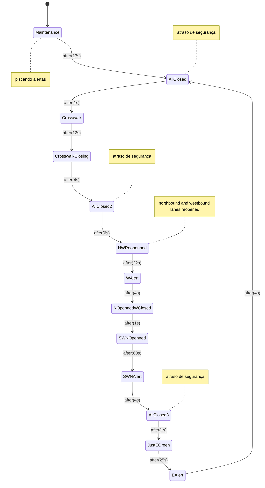

https://ww1.microchip.com/downloads/aemDocuments/documents/MCU08/ProductDocuments/DataSheets/Atmel-7810-Automotive-Microcontrollers-ATmega328P_Datasheet.pdf

...




## Compilar, gravar e testar

Ferramentas necessárias no Linux/WSL: `avra`, `avrdude` e `picocom`.

Execute os comandos dentro da pasta `draft/`. Neste exemplo, a placa está conectada em `/dev/ttyUSB0`; ajuste a porta se necessário.

### Compilar para a placa

```bash
avra -o draft.hex draft.asm
```

### Gravar no Arduino Uno

```bash
sudo avrdude -c arduino -p m328p -P /dev/ttyUSB0 -b 115200 -U flash:w:draft.hex
```

Para compilar e gravar somente se a compilação terminar com sucesso:

```bash
avra -o draft.hex draft.asm &&
sudo avrdude -c arduino -p m328p -P /dev/ttyUSB0 -b 115200 -U flash:w:draft.hex
```

### Monitorar a saída serial

```bash
sudo picocom -b 9600 /dev/ttyUSB0
```

Para sair, pressione **Ctrl+A**, depois **Ctrl+X**. Feche o monitor antes de gravar novamente.

> A gravação pelo bootloader usa 115200 baud. As mensagens do firmware usam 9600 baud.

### Compilar para o SimulIDE

```bash
avra -D SIMULIDE -o draft_simulide.hex draft.asm
```

Carregue `draft_simulide.hex` no ATmega328P do circuito simulado e configure o clock para **16 MHz**.

A definição `SIMULIDE` substitui `sleep` por `nop`, contornando a limitação observada no simulador. Os nomes separados evitam sobrescrever o firmware destinado à placa.

### Limpar arquivos auxiliares

Opcionalmente:

```bash
rm -f draft.obj draft.cof draft.eep.hex
```

O código-fonte e os firmwares `draft.hex` e `draft_simulide.hex` são preservados.
